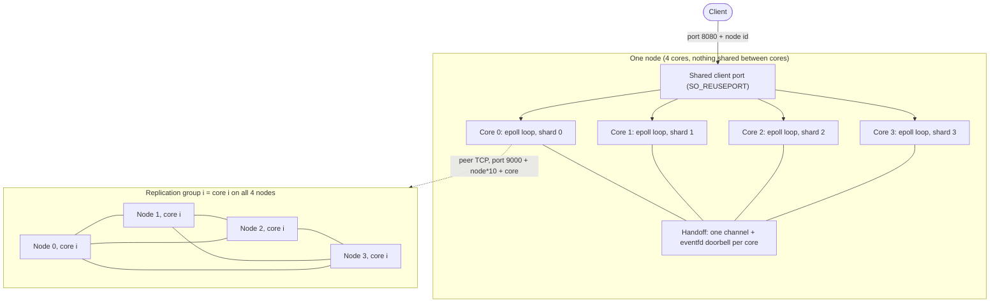

## Core Reactor KV

This is a sharded key value store in rust it uses epoll per core , leader election and majority acknowledge writes.

## What did I Build

These are some things I build in project:

- In memory Key Value Storage.
- Thread per core shared nothing architecture.
- Leader election and acknowledgement.
- MPSC communication and connection transfer core to core.
- Connection between the nodes in pure TCP connection.


## Why did I build it

After my tcp server I needed to build something better. I was interested in how can I make db over a tcp server.

So I researched and found out about the shared nothing core per thread with multiple nodes with election between nodes this was a new concept to me and industry wise used so i decided to use it.

Also nothing shared with core per thread was a new concept to me so I decided to build over it.


## Scope

This project works under certain scope :

- The storage is currently in memory .
- The nodes are currently hardcoded to 4 and cores are also 4.
- Election and heartbeat follow raft and replication needs acknowledgement but has no replicated log or persistence.
- Writes sent to a non-leader get a -MOVED reply; automatic forwarding is not implemented.


## Architecture



This is the architectural diagram for our project which shows how the whole thing is build

- A single port can be used to route to any of core in the same node using `SO_REUSEPORT` .
- We are sharding keys based on the cores .
- Core-to-core channels are unbounded crossbeam channels, so there is no backpressure.
- Also the leader are chosen based on the core group not node for example , each core 0 will choose a leader among them in the same core across all nodes.
- Writes are only allowed for the leader if the core is not the leader it gives a `-MOVED <node> <host:port>`to the user to tell the user to switch to another node.


## Quick Start

To start the application i have written a script in the `src/bin/` folder named `cluster_launcher.rs`.

It launches all 4 nodes at once then nodes decide the leader on their own.

You can use the below command to start it:
```
cargo run --bin cluster_launcher
```

You can command to connect to running server via the terminal in linux:
```
nc 127.0.0.1 8080
```

Also the current 4 nodes structure you can increment the 8080 by 1 to get to next node like 8080,8081, etc.

## Protocol

Clients connect over TCP to port `8080 + node id` and send one text command per line, ending in `\n`. Send one command at a time and wait for the reply before sending the next. Commands are case-sensitive.

| Command | Meaning |
|---|---|
| `SET <key> <value>` | Store a value. Only sent to the leader of the key's core group. |
| `GET <key>` | Read a value from the node you are connected to. |
| `DELETE <key>` | Remove a key. Only sent to the leader. |

| Reply | When |
|---|---|
| `+OK` | A `SET` or `DELETE` reached a majority (3 of 4 nodes). |
| `+<value>` | `GET` found the key. |
| `-ERR KEY_NOT_FOUND` | `GET` on a key that does not exist. |
| `-MOVED <node> <host:port>` | This node is not the leader. Reconnect to that address and resend. |
| `-ERR LEADER_UNAVAILABLE_TRY_AGAIN` | No leader is known yet. Retry shortly. |
| `-ERR TIMEOUT` | No majority within 2 seconds. The write may still have reached some nodes. |
| `-ERR UNKNOWN_COMMAND` | The command is not recognized. |

Notes:
- A write reply comes only after a majority has acknowledged, so it can take a few milliseconds.
- `DELETE` replies `+OK` whether or not the key existed.
- Keys and values are single words with no spaces. For `SET key hello world`, only `hello` is stored.
- Keep the key and value together under about 120 bytes.
- A `GET` on a follower can briefly return an older value, because followers apply writes asynchronously.

## How a write works

- User is connected to a random core in the node.
- Before performing the operation calculate the shard.
- If the shard does't match then use the crossbeam channels and doorbell to send the data and to tell the other core about it.
- Then on the correct shard check if the core is leader of its group.
- If the core is not leader give `-MOVED <node> <host:port>`.
- If the core is leader then create the `PendingWrite` struct and store the state and send the {key} and {value} to each node.
- When the node writes the value they send back a acknowledgement which turns the state true for them in the struct. 
- When 3 of 4 nodes have acknowledged, the leader writes to its own store and replies +OK
- Also if a request is not completed under 2 seconds it send a timeout 


## Design Decisions

### Core per thread

core per thread avoids locks on the data, because only one thread touches a shard.  

### Doorbell handoff

The decision was to use sharding to store each KV pair so that access over the nodes is uniform and you don't have to guess core so when a key lands on shard it should't have been we use crossbeam with MPSC to activate the doorbell and send the connection state there handing over the connection itself.

### Majority Ack

It was a important part of architecture as i was not able to add the proper raft based system for writes i used a simpler version where the node just write and send back a single on which the leader act.

### Timeout Queue

I added the timeout queue because I cannot let the user hold forever for the write after 2 seconds if the acknowledgement is not there fromt the nodes then send a error rather than waiting forever.


## Bugs I found

### Forgot Replication on Forwarded Connections

On the block where I perform the write for the forwarded connections I forgot to actually use the replication logic so while testing some of the write works fine when the shard was correct but when the shard was wrong and we use forwarding the replication didn't happen.

### Relplies lost due to use of wrong Fd

In the `DoorBell` part for the forwarding replies were lost becuase I used wrong fd to send the replies and I kept wondering about missing replies.

### Restart failure

Multiple cores on a node uses same port so there was conflict between the cores so we use `SO_REUSEPORT` which allows multiple cores to access a port and route request to any one of the core 

### Starting nodes by hand

When I started testing I didn't used the script instead started terminals by hand which caused delay and the first node to be started died before others were even active . I added a proper script to start all the 4 nodes quicky and also added retry mechanism along so that if it fails it retires.


## Limitations

### No persistance

The current version is only in memory and the data is not persistant if the server goes down.

### No  persistance logs

In the current version we implement a very simple leader election and no persistant election and replication logs so if a leader goes down then the logs also become impossible to reach and thus the election and replication logs are gone.

### Raft timer only runs when a core is idle

Raft timer is made to only work when the core is idle if the core is already working then the timer would never get to 0 and the leader would not change anyways.

### Unbounded channels

The channels connecting the cores are unbounded and cannot handle backpressure.

### Hardcoded nodes and cores

Currently the nodes and cores are hardcoded in the code itself so you will only get 4 cores and 4 nodes.

### Limit to the size of key value pair

The current limit to the data is 128 bytes so the key and value should be under 128 bytes or else it will not work.

## Future work

- Persistant logs for the election to make sure proper failure logs for the leader election

- Persistant logs for the replication with proper commit and acknowledgement structure so that writes only happen aftr proper commit and acknowledgement.


## Project layout

```text
src/
├── main.rs            starts one event-loop thread per core
├── types.rs           connection, connection type, pending write
├── conn_io.rs         socket reads and writes, listener setup
├── command.rs         SET / GET / DELETE and write timeouts
├── peer.rs            election, heartbeat and replication messages
├── raft_net.rs        peer TCP connections and packet framing
├── election.rs        vote and heartbeat handling
├── state.rs           Raft state (term, role, timers)
├── message.rs         wire format for peer messages
├── sharding.rs        key to core mapping
├── inter_core.rs      core-to-core channels and doorbell
└── bin/
    ├── cluster_launcher.rs   starts all 4 nodes
    └── loadgen.rs            load generator used for the benchmarks
```