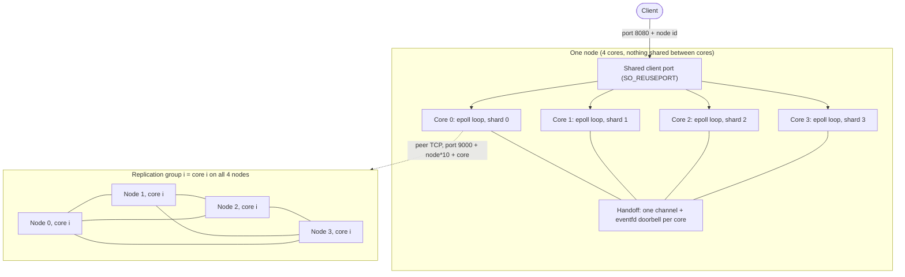

## Core Reactor KV

This is a sharded key value core in rust it uses epoll per core , leader election and majority acknowledge writes.

## What did I Build

These are some things I build in project:

- In memory Key Value Storage.
- Thread per core shared nothing architecture.
- Leader election and acnowledgement.
- MPSC communication and connection transfer core to core.
- Connection betweeen the nodes in pure TCP connection.


## Why did I build it

After my tcp server I needed to build something better. I was interested in how can I make db over a tcp server.

So I researched and found out about the shared nothing core per thread with multiple nodes with election between nodes this was a new concept to me and industry wise used so i decided to use it.

Also nothing shared with core per thread was a new concept to me so I decided to build over it.


## Scope

This project works under certain scope :

- The storage is currently in memory .
- The nodes are currently hardcoded to 4 and cores are also 4.
- Election and heartbeat follow raft and replication needs acknowledgement but has no replicated log or persistence.
- Architecture to automatically redirect to the leader for writes.


## Architecture



This is the architectural diagram for our project which shows how the whole thing is build

- A single port can be used to route to any of core in the same node using `SO_REUSEPORT` .
- We are sharding keys based on the cores .
- Core-to-core channels are unbounded crossbeam channels, so there is no backpressure.
- Also the leader are chosen based on the core group not node for example , each core 0 will choose a leader among them in the same core across all nodes.
- Writes are only allowed for the leader if the core is not the leader it gives a `-MOVED <node> <host:port>`to the user to tell the user to switch to another node.


## Quick Start

To start the application i have written a script in the `src/bin/` folder named `cluster_launcher.rs`.

It launches all 4 nodes at once then nodes decide the leader on their own.

You can use the below command to start it:
```
cargo run --bin cluster_launcher
```

You can command to connect to running server via the terminal in linux:
```
nc 127.0.0.1 8080
```

Also the current 4 nodes structure you can increment the 8080 by 1 to get to next node like 8080,8081, etc.

## Protocol

Clients connect over TCP to port `8080 + node id` and send one text command per line, ending in `\n`. Send one command at a time and wait for the reply before sending the next. Commands are case-sensitive.

| Command | Meaning |
|---|---|
| `SET <key> <value>` | Store a value. Only sent to the leader of the key's core group. |
| `GET <key>` | Read a value from the node you are connected to. |
| `DELETE <key>` | Remove a key. Only sent to the leader. |

| Reply | When |
|---|---|
| `+OK` | A `SET` or `DELETE` reached a majority (3 of 4 nodes). |
| `+<value>` | `GET` found the key. |
| `-ERR KEY_NOT_FOUND` | `GET` on a key that does not exist. |
| `-MOVED <node> <host:port>` | This node is not the leader. Reconnect to that address and resend. |
| `-ERR LEADER_UNAVAILABLE_TRY_AGAIN` | No leader is known yet. Retry shortly. |
| `-ERR TIMEOUT` | No majority within 2 seconds. The write may still have reached some nodes. |
| `-ERR UNKNOWN_COMMAND` | The command is not recognized. |

Notes:
- A write reply comes only after a majority has acknowledged, so it can take a few milliseconds.
- `DELETE` replies `+OK` whether or not the key existed.
- Keys and values are single words with no spaces. For `SET key hello world`, only `hello` is stored.
- Keep the key and value together under about 120 bytes.
- A `GET` on a follower can briefly return an older value, because followers apply writes asynchronously.

